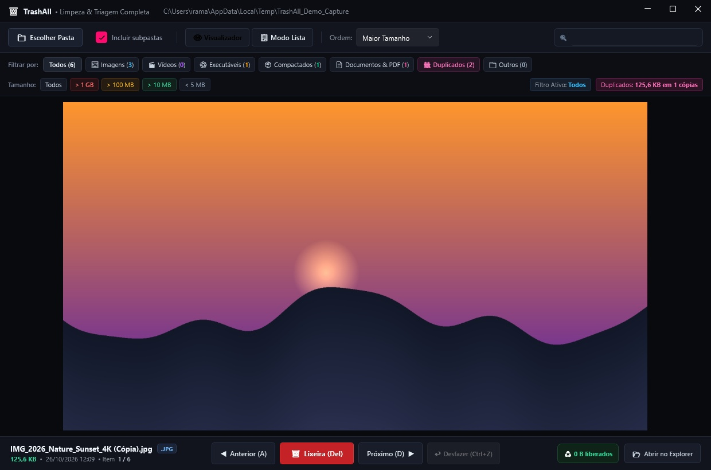
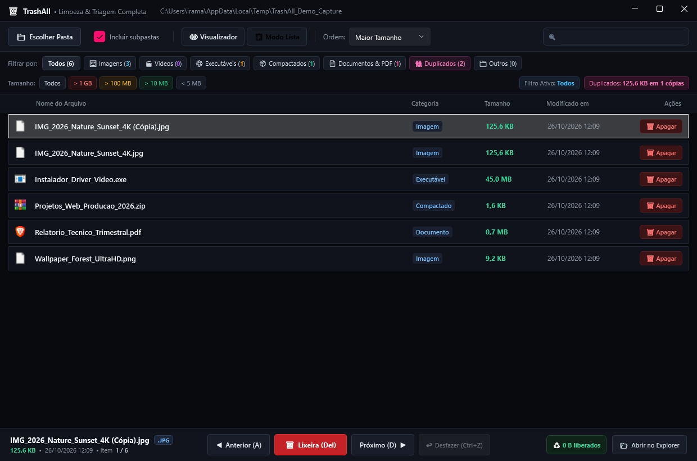
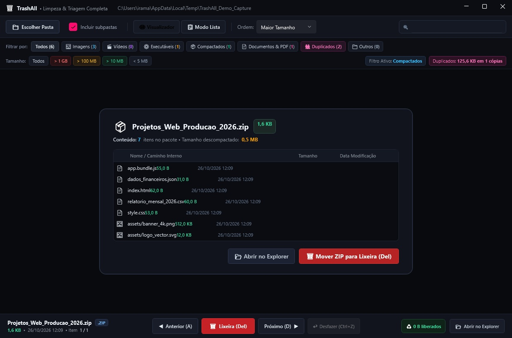

# TrashAll

Triagem e limpeza rápida de arquivos de mídia para Windows.

[](https://github.com/juniodevs/TrashAll/releases)
[](https://github.com/juniodevs/TrashAll)
[](https://dotnet.microsoft.com/)
[](LICENSE)

Site do projeto: [juniodevs.github.io/TrashAll](https://juniodevs.github.io/TrashAll/)

---

## O que é

O TrashAll é um aplicativo desktop para Windows voltado para organização e exclusão rápida de arquivos acumulados em pastas de downloads, capturas de tela, fotos e vídeos.

O fluxo de navegação funciona diretamente pelo teclado: o programa abre a pasta selecionada, exibe o arquivo na tela e permite decidir se ele será mantido ou movido para a Lixeira do Windows.



---

## Recursos principais

### Varredura rápida
Exibe o primeiro arquivo encontrado em menos de 1 segundo enquanto continua indexando o restante da pasta em segundo plano.

### Envio para a Lixeira e desfazer (Ctrl+Z)
Os arquivos apagados são enviados para a Lixeira do Windows. Se um item for excluído por engano, o atalho Ctrl+Z recupera o arquivo diretamente da Lixeira via integração com o Windows Shell e o restaura no local de origem.

### Detecção de duplicados via SHA-256
Localiza arquivos idênticos em duas etapas: agrupamento inicial por tamanho em bytes e confirmação por hash SHA-256. O aplicativo exibe as cópias lado a lado, indica qual é o arquivo original e calcula o espaço total ocupado pelas cópias.



### Leitura de pacotes compactados sem extração
Abre arquivos nos formatos ZIP, JAR e APK exibindo a árvore de conteúdo interno diretamente na tela, sem descompactar os dados no disco.



### Filtros por tamanho e busca direta
- Botões para filtrar itens maiores que 1 GB, 100 MB ou 10 MB.
- Campo de busca instantânea por nome ou extensão.
- Alternância entre o modo visualizador de mídia e a visualização detalhada em tabela.

---

## Formatos suportados

- Imagens: JPG, PNG, WEBP, GIF, BMP, TIFF, SVG, ICO e PSD/PSB (arquivos do Photoshop decodificados via ImageMagick).
- Documentos: PDF (renderiza a primeira página para conferência rápida via Docnet).
- Vídeos e áudio: MP4, MKV, MOV, WEBM, AVI, WMV, MP3, WAV, FLAC.
- Pacotes compactados: ZIP, JAR, APK (com leitor interno).
- Executáveis e instaladores: EXE, MSI, BAT, CMD, ISO.

---

## Atalhos de teclado

| Tecla | Ação |
|---|---|
| `D` ou `Seta Direita` | Próximo arquivo |
| `A` ou `Seta Esquerda` | Arquivo anterior |
| `Delete`, `X` ou `Backspace` | Mover para a Lixeira |
| `Ctrl + Z` | Desfazer última exclusão (restaura da Lixeira) |
| `Espaço` | Reproduzir ou pausar vídeo |
| `F` ou `F11` | Alternar tela cheia |

---

## Download

Os binários compilados estão disponíveis na página de lançamentos do GitHub:

- **Versão portátil única (Recomendada)**: executável independente em arquivo ZIP. Não exige instalação prévia do .NET Runtime no computador.
- **Versão dependente de framework**: pacote mais leve em arquivo ZIP, voltado para computadores que já possuem o .NET 8 Desktop Runtime instalado.

Todos os pacotes são acompanhados pelo arquivo `SHA256SUMS.txt` com as somas de verificação geradas no processo de publicação.

Página de lançamentos: [github.com/juniodevs/TrashAll/releases](https://github.com/juniodevs/TrashAll/releases)

---

## Como compilar e executar

Requisitos:
- Windows 10 ou 11 (64-bit)
- .NET 8.0 SDK

Execução em modo de desenvolvimento:
```bash
dotnet run
```

Publicação da versão portátil em arquivo único:
```bash
dotnet publish -c Release -r win-x64 --self-contained true -p:PublishSingleFile=true -p:IncludeNativeLibrariesForSelfExtract=true -p:EnableCompressionInSingleFile=true -o ./dist
```

---

## Arquitetura e contribuição

Instruções para desenvolvimento, arquitetura de serviços e regras do projeto estão documentadas no arquivo [AGENT.md](AGENT.md).

---

## Licença

Este projeto é distribuído sob a licença MIT. Consulte o arquivo `LICENSE` para detalhes.
